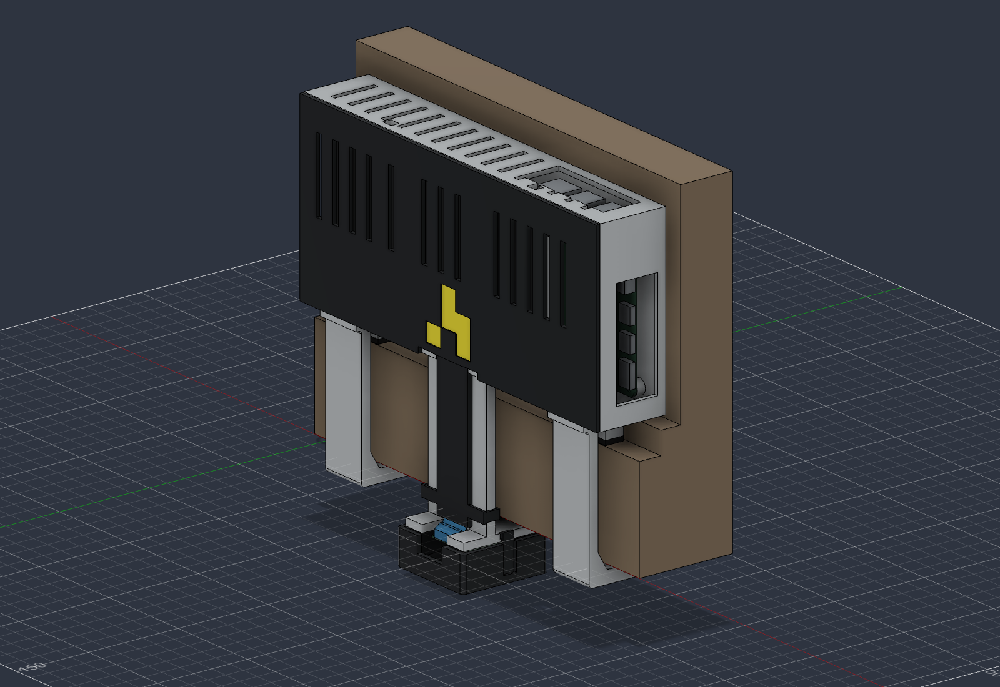

# attendance-camera-v10 CAD

Current prototype: direct PETG screw mounts, **no heat-set inserts or nuts**. v9's covers, reinforced hooks, port access, downward camera and covered ribbon route are retained.

- [Hardware and BOM](../../docs/hardware/v10/README.md)
- [Assembly and screw-fit procedure](../../docs/hardware/v10/assembly.md)
- [Printing instructions](../../docs/hardware/v10/printing.md)
- [Copy-paste operator notes](PRINT-ADMIN-NOTES.md)
- [Editable Fusion design](doorframe-camera-simple-v10.f3d)
- [STEP assembly](doorframe-camera-simple-v10.step)
- [Oriented STLs](stl/)

Print the screw-fit coupon and frame gauge before the large body. The provisional main-body pilots are 1.7 mm for M2 and 2.1 mm for M2.5; confirm fit with the actual metal screws and PETG. The coupon has six labeled tests and simulates the PCB thicknesses. It replaces the heat-set coupon.

There are three installed printed parts and two test pieces. The native design and STEP also include reference hardware and the frame. `validation.json` records native geometry checks, `mesh-validation.json` records oriented meshes, and `manifest-sha256.json` identifies the files. Physical fit and load capacity have not been tested.

