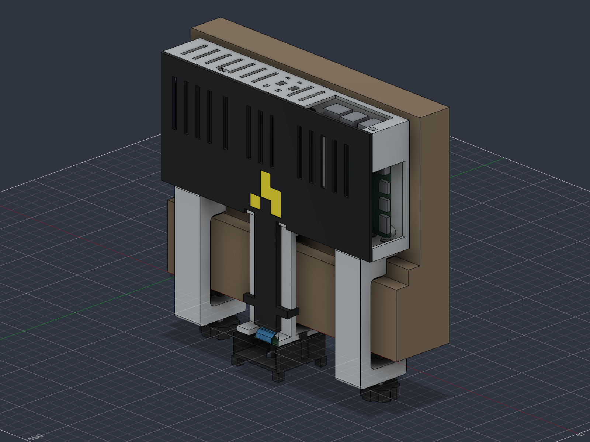
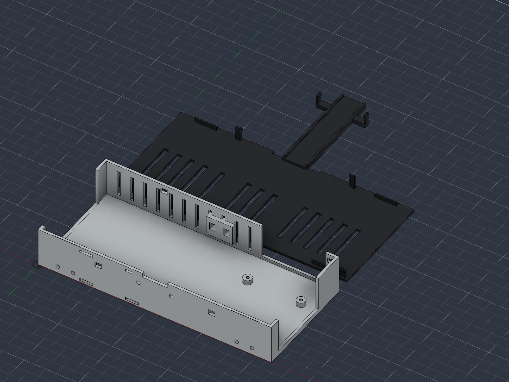
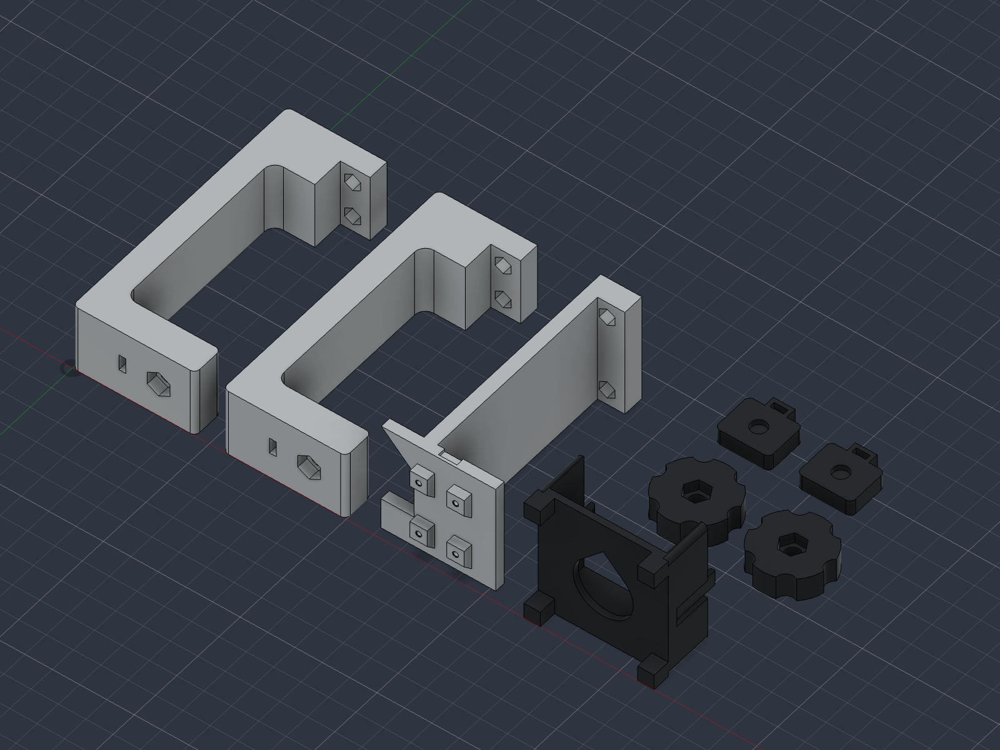

# attendance-camera v11

Adjustable padded clamps replace v10's fixed friction hooks. Two identical C brackets print on their broad sides and attach to the case with bench-installed screws. Hand knobs drive metal M5 screws against separate padded pressure shoes after hanging. Nothing screws into the doorframe.

- [Fusion source](doorframe-camera-clamped-v11.f3d)
- [STEP assembly](doorframe-camera-clamped-v11.step)
- [Oriented print meshes](stl/): seven models, ten installed pieces
- [Hardware and assembly](../../docs/hardware/v11/README.md)
- [Print operator notes](PRINT-ADMIN-NOTES.md)
- [Plate 1 layout](plate-1.png) and [plate 2 layout](plate-2.png)

The case prints back-down, and the cover/ribbon roof has one flat exterior face. The battery and Pi openings reach the separate cover edge, removing the old long lintels. Camera supports and the guard aperture use 45-degree transitions. The camera remains the Duckiedrone's Waveshare RPi Camera G, pointing straight down. The flat Purdue Hackers logo and battery/Pi port access remain.

The guard's corner feet project 3 mm past the **approximate modeled** lens nose. The actual lens extension and view still need checking; this is not a drop-protection rating. Two roof slots provide an accessible tether attachment.

No coupons or gauges are included. Geometry checks cover the assembled and released clamp positions, port corridors, nominal ribbon envelope, PCB screw pilots and ten single-solid installed parts. All seven STL meshes are closed and connected. These checks do not establish physical fit, grip, long-term creep or the strength of the door trim. The print layouts are CAD previews, not sliced Bambu Studio projects.

