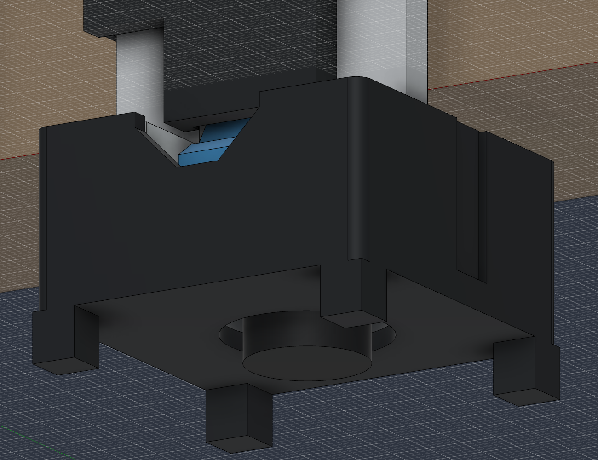
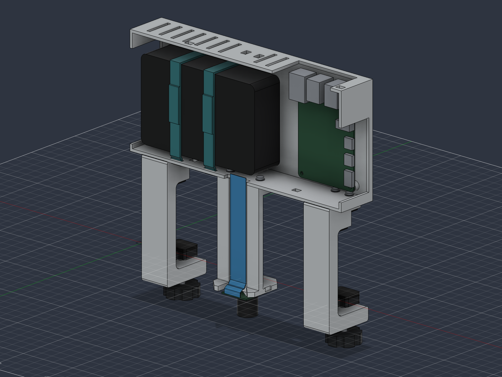
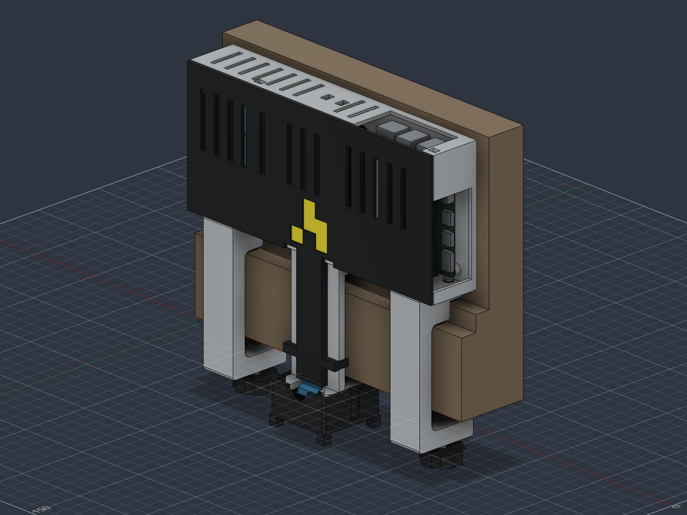

# attendance-camera v12

Current enclosure prototype. This revision closes the camera guard's oversized side opening, removes four leftover roof holes and clears both battery straps. It keeps the padded adjustable clamps, downward-facing Waveshare RPi Camera G, accessible Pi/battery ports and covered ribbon channel.

- [Fusion source](doorframe-camera-clamped-v12.f3d)
- [STEP assembly](doorframe-camera-clamped-v12.step)
- [Oriented print meshes](stl/): seven models, ten installed pieces
- [Hardware and assembly](../../docs/hardware/v12/README.md)
- [Print operator notes](PRINT-ADMIN-NOTES.md)
- [Plate 1](plate-1.png) and [plate 2](plate-2.png)

## Cleanup

The camera guard has continuous side walls, a small chamfered ribbon/service notch and a round 22 mm lens opening. Its interior slopes at 45 degrees so it can print **open rim down**, with the lens opening and corner bumpers facing up. The notch closes with a 6 mm bridge. The carrier corners are chamfered to fit the new interior; **use parts 03 and 04 together from v12**. The clips are 1.6 mm thick. No new fasteners are required.

The black cylinder in the assembly is the existing lens reference, not a printed cap. Reference electronics, straps, hardware and the frame are excluded from the STLs. The four corner feet remain 3 mm below the approximate modeled lens nose; actual lens dimensions and view need checking.

Four tiny roof vent remnants are filled. The two reinforced tether holes, cover latch windows and normal vents remain. The obstructed strap slot pair moves left of the camera carrier. Both pairs now have a full 12 × 2.2 mm opening, and shallow inner back-wall grooves leave space for the rear strap runs. The battery moves 0.5 mm toward the front. Closed 10 × 1.5 mm strap envelopes and their 3 mm front overlaps clear the modeled assembly.

## Verification

The native feature checks, assembled/retracted interference checks, plug/cable envelopes, 16 cleanup volume probes and seven closed connected mesh checks passed. See [validation](validation.json), [cleanup checks](cleanup-validation.json), [cable checks](cable-clearance.json) and [mesh checks](mesh-validation.json).

These are geometry checks. Physical fit, snap retention, clamp load/creep, real cables and optics remain untested. The supplied orientations are CAD layouts; a Bambu Studio layer preview is still required. No coupons, gauges, printer project or G-code are included.

