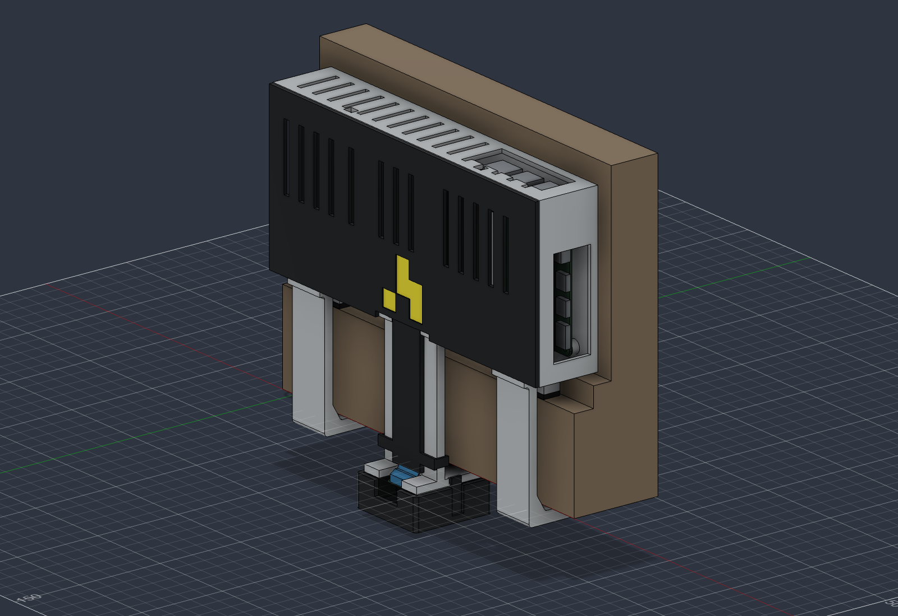

# attendance-camera-v9 CAD

Archived heat-set insert variant. Use [v10](../v10/README.md) for the current design without inserts.

- [Hardware and BOM](../../docs/hardware/v9/README.md)
- [Assembly instructions](../../docs/hardware/v9/assembly.md)
- [Print operator notes](../../docs/hardware/v9/printing.md)
- [Editable Fusion design](./doorframe-camera-simple-v9.f3d)
- [STEP assembly](./doorframe-camera-simple-v9.step)
- [Oriented STLs](./stl/)

There are three installed printed parts and two small test pieces. Only the STLs are print files; the STEP and native design also contain reference hardware and doorframe geometry. The heat-set coupon is optional.

`validation.json` records the native CAD checks; `mesh-validation.json` records the oriented STL checks. `manifest-sha256.json` identifies the exact export files. These reports do not establish physical fit or a structural load rating.

