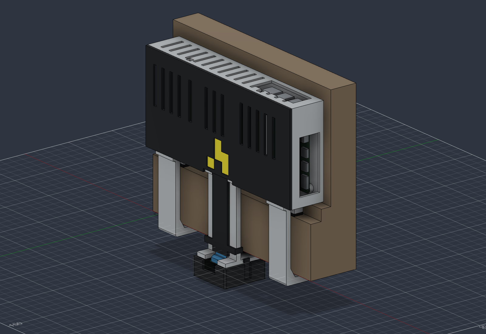

# Documentation

This directory has the documentation for `attendance-camera`.

## Getting started

First, [view the README in `hardware/`](./hardware/README.md) to build the camera enclosure. Then, configure and install the camera feed using the instructions [available in `software/`](./software/README.md).

## Project status

The Pi runs a 1080p30 hardware H.264 camera feed over Tailscale. v9 is the current enclosure prototype: three installed printed parts, with the battery and Pi above the doorframe and the camera facing straight down. It slides onto a rubber-lined mount without tightening anything at height.

The [attendance server](software/Server.md) consumes the feed, detects people locally, counts directional crossings and stores aggregate occupancy data. Its organizer dashboard includes calibration, corrections and CSV export. Accuracy on the installed overhead fisheye view still needs physical validation.

CAD and mesh checks passed. The case has not been physically printed or load-tested, and battery runtime has not been measured. The 4–8 hour target remains unverified.

- [Verification status](./verification.md)
- [CAD scripts and revision history](../cad/README.md)
- [Sources and reference measurements](./references/README.md)
