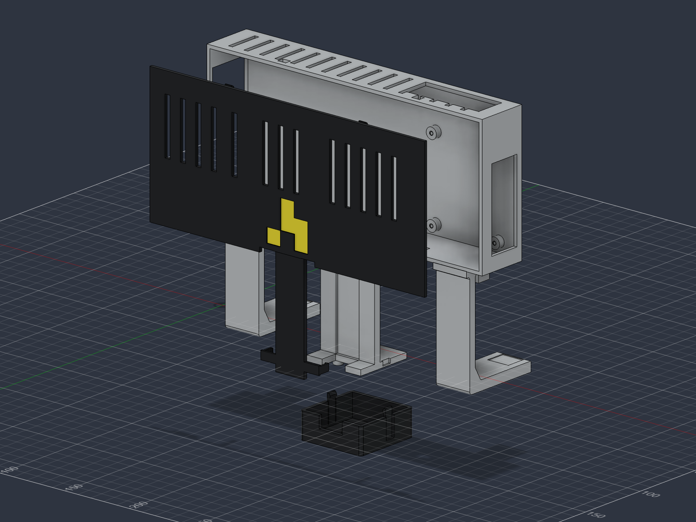

# attendance-camera-v10

Current PETG enclosure prototype, using **eight screws, no heat-set inserts and no nuts**. The Pi and camera screw into smaller pilot holes in the printed bosses. The front cover and downward camera guard still clip on; the whole assembly slides onto the padded frame without tightening anything at height.

## BOM

| Quantity | Part | Notes |
|---|---|---|
| 1 | Raspberry Pi 4 | Existing board; mounting holes stay unmodified |
| 1 | Waveshare RPi Camera G / OV5647 fisheye | Duckiedrone camera; 25 × 24 mm PCB, 21 × 13.5 mm mounting pitch |
| 1 | INIU P51L-E2, 20,000 mAh | Target envelope 115 × 73 × 29 mm; confirm the actual pack |
| 1 each | CSI ribbon and USB-C power lead | Check length, connector orientation and cable bends |
| 4 | M2.5 × 6 mm metal socket-cap screws | ISO 4762 / DIN 912, 0.45 mm pitch; Pi |
| 4 | M2 × 4 mm metal socket-cap screws | ISO 4762 / DIN 912, 0.4 mm pitch; camera |
| 2 | 10 mm hook-and-loop straps | Battery retention |
| 2 each | Soft rubber/neoprene pads | 20 × 10 × 3, 20 × 9 × 3 and 16 × 14 × 3 mm |
| As needed | Soft battery padding and independent retaining tether | Fit and overhead retention |
| 3 | Installed PETG prints | Integral body, snap cover and camera guard |

The screw specifications are unchanged from v9. Confirm the actual screws are metal and the stated lengths; nylon screws should not be used to form the threads. No M3 hardware is needed, and M3 screws must not be forced through either PCB.

## Fit before the full print

The main body currently has **Ø2.1 mm Pi pilots** and **Ø1.7 mm camera pilots**. These are provisional starting diameters, not a verified fit for every printer and PETG. Print the new [screw-fit coupon](../../../cad/v10/stl/08-screw-fit-test-coupon.stl) using the same material, profile and supplied orientation before printing the large body. It tests M2 pilots of 1.6/1.7/1.8 mm and M2.5 pilots of 2.0/2.1/2.2 mm with the actual screw lengths and simulated board thicknesses.

Direct plastic threads suit infrequent assembly. If the boards need repeated removal, use a revision with matching M2/M2.5 captive nuts or inserts. The makerspace's M3 inserts do not replace the smaller hardware. [FIRST's fastening guidance](https://ftc-docs.firstinspires.org/en/latest/manufacturing/3d_printing/designing_and_slicing/working_with_screws/working_with_screws.html) describes this wear limitation.

## Printing and assembly

- [CAD, STEP and oriented STLs](../../../cad/v10/)
- [Assembly and screw-fit procedure](assembly.md)
- [Print settings and orientations](printing.md)
- [Copy-paste operator notes](../../../cad/v10/PRINT-ADMIN-NOTES.md)

Use PETG, 0.20 mm layers, 6 walls and 30% gyroid, with local solid infill around the retaining arms. Geometry and mesh checks passed; physical screw fit, snap force, loaded retention, cable fit and warm creep remain untested. Test the loaded assembly at low height before overhead use.
