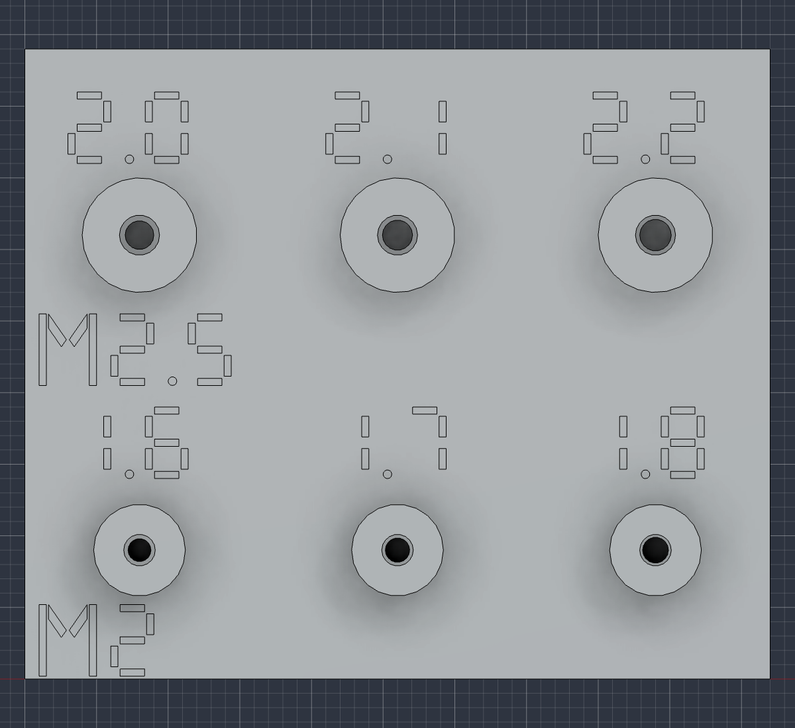

# Doorframe camera — direct screw mounts v10

**Three installed printed parts, eight screws, no inserts or nuts.** Assemble on a table; the completed mount slides onto the rubber-lined doorframe. No screws are tightened at height.

## Parts

1. `01-integral-case-mount-and-camera-holder.stl`
2. `02-snap-on-front-cover.stl`
3. `03-snap-on-downward-camera-guard.stl`

The frame-fit gauge and new screw-fit coupon are test pieces, not installed parts. The [native Fusion file](../../../cad/v10/doorframe-camera-simple-v10.f3d) is editable; the STEP includes reference electronics and the frame. Only the separate STLs are print files.

v10 retains v9's reinforced hooks, covered ribbon channel, recessed Purdue Hackers logo, camera placement and port access. It replaces only the eight insert pockets with direct-screw pilots and replaces the heat-set coupon. The covers and camera guard geometry are unchanged. The archived [v9](../v9/README.md) remains the heat-set-insert alternative.

## Screws and pilot holes

| Location | Quantity and screw | Printed pilot | Boss OD | Entry relief | Nominal thread engagement | Tip clearance |
|---|---|---|---|---|---|---|
| Pi | 4 × M2.5 × 6, pitch 0.45 mm | Ø2.1 × 5 mm deep | 8 mm | Ø2.8 × 0.2 mm | 4.2 mm | 0.6 mm |
| Camera | 4 × M2 × 4, pitch 0.4 mm | Ø1.7 × 4 mm deep | 6.4 mm | Ø2.2 × 0.2 mm | 2.6 mm | 1.2 mm |

Use metal socket-cap screws to ISO 4762 / DIN 912. Length is measured under the head. M2.5 uses a 2 mm hex key; M2 uses a 1.5 mm hex key. The calculation assumes a 1.6 mm Pi PCB and a 1.2 mm camera PCB; the camera thickness is an assumption to check on the actual board. Do not substitute longer screws or countersunk heads without revisiting the stack.

The holes are smooth pilots, not printed helical threads. The screw forms its thread in the PETG. The quoted engagement is the geometric overlap after the entry relief; it is not a measured holding strength. Actual hole dimensions and fit depend on the print.

The source screw dimensions remain [M2 × 4](https://www.accu.co.uk/metric-cap-head-screws/3790-SSCF-M2-4-A2) and [M2.5 × 6](https://www.accu.co.uk/metric-cap-head-screws/3804-SSCF-M2-5-6-A2). See [hardware.json](../../../cad/v10/hardware.json) for the complete specification.

## Test the screw fit first

1. Print `08-screw-fit-test-coupon.stl` in the same PETG and profile as the case, preserving its supplied side orientation. The holes must be horizontal, as on the main print. Clear loose debris; do not pack the small bores with supports.
2. Use the **M2 × 4** screws in the **M2** row and **M2.5 × 6** in the **M2.5** row. The printed numbers are pilot diameters in millimeters. Start with **1.7** and **2.1**, which match the exported case. The coupon already includes a clearance section that simulates PCB thickness; extra washers are not required for this test.
3. Turn the screw slowly by hand with a short hex key. It should start straight, form a thread and seat without splitting or stripping the boss. Stop if it binds, the boss cracks, or the screw spins without tightening. Do not use a powered driver or try to prove strength by tightening until it fails.
4. If the middle size does not fit well, compare the adjacent sizes and request a body export using the successful diameters before the full print. A better result in another test hole does **not** update the main STL. The Fusion parameters are `camera_screw_pilot` and `pi_screw_pilot`; any adjustment must also update the documented dimensions and validation targets before re-export. Do not scale the whole case to compensate.

This coupon checks screw formation and fit, not the structural load capacity or reuse life of the finished mount. If only nylon screws are available, use a matching metal screw or suitable tap to prepare the threads; do not force nylon screws to cut them. A change to tapped threads may require a different pilot, so test that exact process first.

## Assemble at table height

1. Test the upward-step frame gauge with the intended pads before printing the body. Follow the [print instructions](printing.md).
2. With electronics removed, gently pre-form each thread using the correct metal screw. Stop at the intended insertion depth: **4.4 mm for Pi screws and 2.8 mm for camera screws**, measured into the mounting face. A temporary spacer matching the PCB thickness, or a visible depth mark on the screw, helps avoid bottoming out. Withdraw the screw once and remove debris before fitting electronics.
3. Place each PCB on its supports. Restart the screws in the existing threads, turning backward gently until they locate, then tighten only until the board is seated. Do not flex the PCB or repeatedly remove the screws. Do not enlarge the PCB holes for M3 hardware.
4. Pad and strap the battery using two 10 mm hook-and-loop straps. Put its charging/USB end toward the large left opening. Fit the power lead with room for the actual plugs and bends.
5. Route the CSI ribbon through the floor entry and recessed channel, then clip on the front cover/ribbon roof and camera guard. The nominal ribbon passage is 18 mm wide × 3.2 mm deep. Its modeled 16 × 0.35 mm cable envelope does not verify the actual ribbon stiffeners, connector orientation, length or bend radii.

Direct PETG threads are for infrequent board removal. Normal access uses the snap covers and port openings. If repeated PCB servicing is expected, use matching captive M2/M2.5 nuts or heat-set inserts in a revised model. [FIRST's guidance](https://ftc-docs.firstinspires.org/en/latest/manufacturing/3d_printing/designing_and_slicing/working_with_screws/working_with_screws.html) notes that repeated disassembly quickly weakens direct plastic threads.

## Camera and port access

The camera is the Duckiedrone's **Waveshare RPi Camera G**, with a 25 × 24 mm PCB and verified 21 × 13.5 mm mounting pitch. Its lens points straight down below the front edge of the frame. The 22 mm guard aperture surrounds a simplified lens envelope; verify the actual lens extension and ensure the guard does not obstruct the view.

The battery sits on the left, with charging accessible through the left opening. The target is an INIU P51L-E2, 115 × 73 × 29 mm; check the actual pack. The Pi is on the right, with USB/Ethernet above and USB-C, HDMI and audio to the right. Clearance corridors were checked, but real plug bodies and cable bends were not modeled. microSD access may require lifting the assembly off the frame.

Release the cover's four top/bottom clips and two lower ribbon-roof catches before pulling the cover toward the room. The cover does not carry the camera or hanging loads. The official flat logo remains a 32 mm-wide, 0.6 mm-deep recess with 1.4 mm wall remaining; yellow in the render is optional paint fill.

## Doorframe mounting and checks

The frame underside is Z=0. Its front face at Y=0 rises 55 mm, followed by a 12 mm ledge, a 12 mm rise and an 11 mm upper ledge. The assumed wall is beyond Y=23 above the upper ledge; the door boundary is Y=52. The case ends at Y=22.4 and the arms at Y=45. Confirm the real trim and door movement with the gauge.

Four pads bear on the upward-facing ledges, and two integral arms catch beneath the overhang. The model assumes 3 mm soft rubber compressed to 2.5 mm. Use two pads each of 20 × 10, 20 × 9 and 16 × 14 mm. Slide the assembled mount on from the room side. Do not force it if the pad compression or frame fit differs.

Native checks confirm three installed single-solid parts, healthy features, no modeled positive-volume interference, downward optical axis, port/ribbon clearances and eight correctly sized pilot cylinders. Exported meshes are checked separately for closed edges, one connected component, winding and positive volume. These are geometry checks, not a load rating. Test the complete warm, loaded assembly at low height for slipping, cracking and permanent deformation; use independent retention for overhead installation.

Hardware identity sources: [Duckietown camera](https://docs.duckietown.com/daffy/opmanual-dd24/preliminaries/dd24-components-description.html#rpi-camera-g-with-fisheye-lens-and-cable), [Waveshare Camera G](https://www.waveshare.com/product/rpi-camera-g.htm), [Pi 4 drawing](https://datasheets.raspberrypi.com/rpi4/raspberry-pi-4-mechanical-drawing.pdf), [INIU P51L-E2](https://iniushop.com/products/iniu-p51l-e2-power-bank-45w-20000mah).
