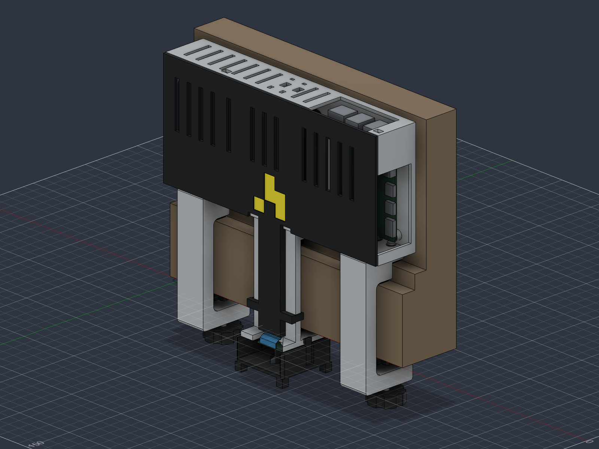

# attendance-camera v11

**Archived. Use [v12](../v12/README.md) for current printing and assembly.**

Two adjustable padded screw clamps replace the fixed hooks. The completed unit rests on the upward-facing frame ledges; two hand knobs press padded shoes against the underside. **The knobs must be tightened after placing the camera on the frame.** No drilling or screws into the building are required. All other assembly takes place on a table.

The [editable Fusion design](../../../cad/v11/doorframe-camera-clamped-v11.f3d), [STEP](../../../cad/v11/doorframe-camera-clamped-v11.step) and [oriented STLs](../../../cad/v11/stl/) are in `cad/v11/`. This revision supersedes v10. It is a prototype with native/mesh checks, not a physically validated overhead mount.

## Printed parts

| Model | Quantity | Oriented size, mm | Print face |
| --- | ---: | --- | --- |
| 01 electronics case | 1 | 214 × 98 × 36.4 | Back down, cavity up |
| 02 front/ribbon cover | 1 | 213.6 × 179.3 × 14.4 | Broad exterior down |
| 03 camera guard | 1 | 47.6 × 30.3 × 47.6 | Rear side down, as supplied |
| 04 camera carrier | 1 | 42 × 91 × 42 | Broad side down |
| 05 C clamp | 2 | 45 × 101.5 × 26 | Broad C-shaped side down |
| 06 pressure shoe | 2 | 20 × 20 × 6 | Pad face down, blind seat up |
| 07 hand knob | 2 | 27.36 × 28 × 9 | Flat face down, hex pocket up |

There are ten installed pieces from seven models. The delivery ZIP includes duplicate copies of 05–07 so the operator can print one of every file. There are no coupons or frame gauges. The extra pieces let the clamps print flat, avoid a tall supported combined body, and make a damaged clamp replaceable.

## Hardware

| Quantity | Hardware | Purpose and dimensions |
| ---: | --- | --- |
| 2 | **M5 × 30 mm fully threaded hex-head bolts, DIN 933** | Clamp adjustment; 0.8 mm pitch, 8 mm across flats, 3.5 mm head height |
| 2 | M5 metal hex nuts, DIN 934 | Captured in lower clamp jaws; 8 mm across flats, 4 mm thick |
| 6 | **M3 × 10 mm button-head socket screws, ISO 7380-1** | Four clamp-to-case and two camera-carrier-to-case screws; 0.5 mm pitch, 5.7 mm head diameter, 1.65 mm head height, 2 mm hex key |
| 6 | M3 metal hex nuts, DIN 934 | 5.5 mm across flats, 2.4 mm thick; captured in printed pockets |
| 6 | M3 flat washers, DIN 125 A / ISO 7089 | About 3.2 mm bore, 7 mm outside diameter and 0.5 mm thickness, beneath the M3 screw heads |
| 4 | M2.5 × 6 mm metal socket-cap screws | Pi mounting, into the existing Ø2.1 mm plastic pilots |
| 4 | M2 × 4 mm metal socket-cap screws | Camera PCB mounting, into Ø1.7 mm plastic pilots |
| 2 each | Soft rubber/neoprene pads, 3 mm stock | 20 × 10 mm lower ledge, 20 × 9 mm upper ledge, 20 × 16 mm pressure shoe |
| 2 | Small loose retaining loops of cord or cable tie | Through each shoe and clamp slot; keep the shoe attached when released, with room for 3.5 mm travel |
| 2 | 10 mm hook-and-loop straps | Battery retention |
| 1 | Suitable independent retention tether | Through the paired roof slots to a separate suitable anchor |
| As needed | Soft pack padding, CSI ribbon and USB-C lead | Verify actual cable lengths, plugs and bends |

No heat-set inserts are required. The hand knobs capture **hex bolt heads**; round socket-cap heads will not drive these knobs. Use button heads for the M3 bench screws so the head height clears the electronics. Do not substitute longer M3 screws: the specified 10 mm screws end 0.9 mm inside the jaw surface, with 0.7 mm of thread projecting through the nut. The rubber contact pads remain full rectangles.

See the [US shopping list](sourcing.md) for purchasable sizes, quantities and substitutions, and the [cable routing and clearance check](cables.md) before choosing the power lead. The Pi side opening was lowered by 2 mm during the cable review; download the refreshed v11 case STL if you saved the earlier export.

Standard hardware references: [DIN 933 M5 × 30 bolt](https://www.accu.co.uk/full-thread-hexagon-bolts/1008549-SEBF-M5-30-8-8-BZP), [DIN 934 M5 nut](https://www.accu.co.uk/hexagon-nuts/456462-HPN-M5-C8), [ISO 7380-1 M3 × 10 button screw](https://www.vital-parts.co.uk/hex-socket-button-screws-iso-7380-1/44014-hbs73801-m3-10-109-bzp), and [DIN 934 nut dimensions](https://www.masonsfasteners.com/themes/masonfastners/images/Catalogue1.pdf).

## Bench assembly

1. Deburr the small holes and nut pockets. Fit six M3 nuts into the two clamps and camera carrier. The M3 pockets are 5.8 mm across flats and 4 mm deep. Do not heat-set ordinary hex nuts or force a pocket that is too tight.
2. Attach both clamps and the camera carrier underneath the case using the six M3 × 10 button screws and washers from inside the case. Fully seat the nuts against their pocket shoulders; tighten gently. Perform this before installing the battery and Pi.
3. Put one M5 nut into each lower jaw's 8.3 mm pocket. Insert an M5 hex bolt through each hand knob, head in the knob's hex pocket, and thread it up through the jaw nut. Put the screw tip in the pressure shoe's blind seat. Add a loose shoe-retaining loop; it is a parts retainer, not the overhead safety tether. Confirm the shoe can settle squarely and travel without binding.
4. Fit the six rubber contact pads. Thread the independent tether through the two 5 × 7 mm roof slots around the reinforced 8 × 6 mm bridge. Route it above the case and away from the downward view.
5. Gently form the Pi and camera pilot threads with the correct metal screws, then fit the boards. The PCB holes stay their original sizes; M3 hardware never passes through either PCB. The small plastic threads are for infrequent servicing.
6. Strap and pad the INIU P51L-E2 battery with its charging end toward the left opening. The Pi USB/Ethernet ports face up; power/HDMI/audio face the right opening. The battery reference remains 115 × 73 × 29 mm. Connect a separate USB-A-to-USB-C power lead from the battery's left end to the Pi's right side; route it around the front with gentle bends as shown in the [cable guide](cables.md). The battery's USB-C charging port stays accessible while strapped in.
7. Route the ribbon down its recessed channel, avoiding sharp folds and connector strain. Check the complete ribbon connection to the Pi before closing the cover; the native ribbon envelope only checks the lower channel. Fit the snap-on front/ribbon cover and camera guard. The right upper cover clip has moved beside the USB opening; do not use a v10 cover on this case.

## Frame installation

The model uses the supplied profile: 52 mm overhang, 55 mm front rise, 12 mm ledge, another 12 mm rise and an 11 mm upper ledge. The upper ledge meets the assumed wall at Y=23 mm; the case back is at Y=22.4 mm. The frame and its attachment to the wall must be capable of carrying the assembly.

Loosen the knobs until the shoes can rest on the lower jaws, keeping the bolts threaded into the nuts. The modeled retraction is 3.5 mm, and the screws retract about 4 mm/five turns. Slide the unit onto the ledges, then snug both knobs by hand until the pads grip and the unit does not rock or slide. Do not use a wrench to force the printed clamps. Do not force a frame profile that differs from the model. This design provides adjustment at the lower shoes; it is not a universal-width clamp.

Check the loaded assembly at low height, including the warm Pi, cable handling and any movement from the door. Use the independent tether for overhead installation. Neither the CAD checks nor the bumper geometry establishes a load rating or a fall-survival guarantee.

The lens points straight down. The four corner feet extend 3 mm below the **approximate reference lens nose** and clear a nominal 160° cone originating there. The true lens extension and entrance pupil are not dimensioned by the shared Waveshare PCB drawing. Check the actual live view for obstruction; do not assume the nominal cone verifies the real optics.

## Printing

Use PETG, 0.4 mm nozzle, 0.20 mm layers, six walls, 30% gyroid, six top/bottom layers, and **100% infill for the two clamp brackets**. Keep the supplied orientations. See [paste-ready operator notes](../../../cad/v11/PRINT-ADMIN-NOTES.md), [plate 1](../../../cad/v11/plate-1.png) and [plate 2](../../../cad/v11/plate-2.png).

The case and cover fit within an approximately 214 × 289.3 mm layout before brims. The smaller parts form the second layout. These are placement suggestions, not printer-specific projects. Center/rearrange them as needed for the actual nozzle's printable area, brim and any purge area.

The long port lintels are removed, the ribbon cover lies flat, and the camera support/guard use 45° transitions. Remaining small bridges and horizontal holes need slicer review. Use selective removable supports where needed, keeping them out of screw bores, nut pockets and clip gaps. The layer preview, support volume and print time have not been verified in Bambu Studio; no G-code is provided.

PETG remains recommended for the clamps, clips and warm case. It does not remedy poor layer bonding or an unsuitable frame. [Prusa's PETG guidance](https://help.prusa3d.com/article/petg_2059) and [printing-oriented design guidance](https://help.prusa3d.com/article/modeling-with-3d-printing-in-mind_164135) inform these choices.

## Verified in software

- Ten installed single-solid parts, seven unique meshes; no test pieces.
- No unhealthy native features or modeled collisions, including M3/M5 fastener envelopes, reference electronics, frame, nominal ribbon and port access corridors. The M2/M2.5 screw threads are not modeled; their pilot diameters and nominal engagement are checked separately.
- Both clamped and retracted clamp configurations checked; assembly pose restored in the native file.
- Camera axis measured from its occurrence transform as `[0, 0, -1]`; four Pi and four camera pilot cylinders measured from the actual surfaces.
- All seven oriented STLs have one connected component, closed manifold edges, consistent winding and positive volume.
- The [cable report](../../../cad/v11/cable-clearance.json) checks 35 × 16 × 10 mm plug envelopes, hand-access boxes and a complete external power route with 20 mm/23.75 mm side bends. It gives 1.2 mm beneath the Pi power plug envelope. The real battery port centers, connector housings and full CSI route are not dimensioned in this model.

These checks validate the modeled geometry. Physical fit, clamping force, long-term creep, real cable fit and optics remain to be tested on the actual assembled parts.
