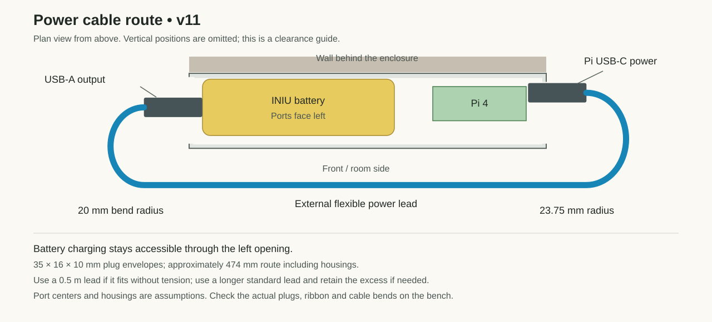

# Power, charging and ribbon access

The battery stays strapped inside the left half of the case. Its port end faces the large left opening; the Pi's USB-C power socket faces the right opening. Connect the battery's USB-A output to the Pi using a separate USB-A-to-USB-C lead. The battery's USB-C charging socket remains accessible through the left opening without removing the pack or front cover.

The power lead runs **outside, around the front of the enclosure**. Leave gentle loops at the side openings and loosely retain the lead with reusable ties; keep it above the camera, out of the door's travel and clear of the clamp knobs. Do not trap it between the case and wall or stretch it tight between connectors. The integral battery cable is not assumed long enough to reach the Pi.

## Cable to use

A standard **0.5 m USB-A-to-USB-C cable rated for 3 A**, such as [StarTech USB2AC50CM](https://www.startech.com/en-us/cables/usb2ac50cm), is the nominal choice. The manufacturer specifies 22/30 AWG conductors, a 3.5 mm cable diameter and maximum product width/height of 15.3 × 7.4 mm. Those values inform the clearance envelopes; the connector overmold length and permitted bend radius were not provided in the retrieved specifications.

The illustrative route uses about **474 mm including two assumed 35 mm plug housings**, with 20 mm and 23.75 mm bend radii at the sides. A 0.5 m lead has limited spare length. If the actual plugs, port locations or strain reliefs need a larger loop, use a standard 1 m lead and tie the excess to the case; do not tighten the bends to make a short lead reach. Prefer a flexible charging lead over a bulky high-speed cable.

INIU lists [5 V / 3 A output for the P51L-E2](https://iniushop.com/products/iniu-p51l-e2-power-bank-45w-20000mah). This access check does not establish uninterrupted power when a charger is connected. Treat charging while operating as unverified battery behavior, not a UPS feature.

## What was checked

The revised Pi side opening starts **2 mm lower** than the first v11 export. A 35 mm-long × 16 mm-wide × 10 mm-thick plug envelope now clears it, including **1.2 mm beneath the Pi power plug**. There is still a 5.6 mm side rail above the case floor. The left opening passes the same envelope for representative battery output and charging positions.

The [native clearance report](../../../cad/v11/cable-clearance.json) checks these plug envelopes, room to grip them from the sides, and a conservative 4 mm envelope around the complete external power cable. It found no intersections with the modeled case, cover, reference electronics, frame, mount or fasteners. Battery port centers are assumptions; they are not measurements of the user's pack. Physical plug insertion, port spacing, strain relief and cable retention still need checking during bench assembly.

## Camera ribbon

The ribbon enters the case through its covered 18 mm-wide lower channel. The model checks a nominal 16 × 0.35 mm ribbon there. The battery-to-front-cover gap is only 4.6 mm: it accommodates a flat ribbon, not a bulky USB lead or a tightly twisted ribbon bundle.

With the cover off, connect the camera and Pi and check the **entire** ribbon route, including its transition into the free space beside the battery, both stiffeners and the connector contact orientation. Use the correct Pi 4 / Camera G ribbon with enough slack for gentle bends; the required full cable length and bend geometry have not been verified. The cover must close freely without pinching or folding the ribbon against the battery. The lower-channel check alone does not prove this fit.

USB/Ethernet remain accessible above the Pi; HDMI/audio share the right opening. The front cover releases for GPIO and CSI connector service. microSD servicing may require taking the assembly off the frame.
