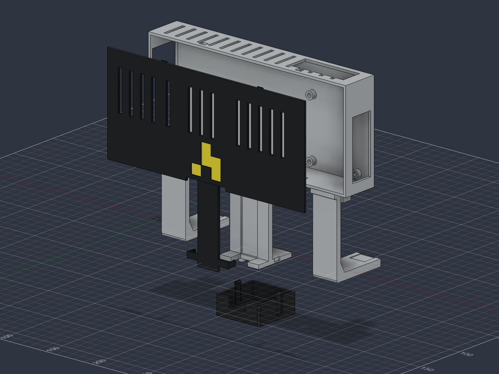

# attendance-camera-v9

Archived heat-set variant. The current [v10](../v10/README.md) uses direct PETG screw pilots and requires no inserts.

## External

The case, hanging arms and downward camera holder form one printed body. A snap front cover includes the ribbon-channel roof, and a snap guard protects the camera. All electronics fastening happens at table height; the assembled mount slides onto rubber-lined doorframe contacts.

The battery is on the left, with charging accessible through the left opening. The Pi is on the right, with USB/Ethernet above and USB-C/HDMI/audio to the right. Actual plug housings and cable bends still need a fit check.

## BOM

| Quantity | Name | Notes |
|---|---|---|
| 1 | Raspberry Pi 4 | Separate CSI ribbon camera; not Pi 5 |
| 1 | Waveshare RPi Camera G / OV5647 fisheye | Camera supplied with the Duckietown Duckiedrone; PCB 25 × 24 mm, mounting pitch 21 × 13.5 mm |
| 1 | INIU P51L-E2, 20,000 mAh | Target envelope 115 × 73 × 29 mm; verify the actual pack |
| 1 | CSI ribbon | Verify length, connector orientation and bends |
| 1 | USB-C power lead | Suitable for Pi power, with accessible battery/Pi connections |
| 4 | M2 × 4 mm socket-cap screws | ISO 4762 / DIN 912, camera mounts |
| 4 | CNC Kitchen M2 × 3 mm heat-set inserts | OD 3.6 mm; printed pockets Ø3.2 × 4 mm deep |
| 4 | M2.5 × 6 mm socket-cap screws | ISO 4762 / DIN 912, Pi mounts |
| 4 | CNC Kitchen M2.5 × 4 mm heat-set inserts | OD 4.6 mm; printed pockets Ø4.0 × 5 mm deep |
| 2 | 10 mm hook-and-loop straps | Battery retention |
| 2 each | Soft rubber/neoprene pads | 20 × 10 × 3, 20 × 9 × 3 and 16 × 14 × 3 mm |
| As needed | Soft battery padding and independent retaining tether | Fit and overhead retention |
| 3 | Installed PETG prints | Integral body, snap cover and camera guard |

The previously identified M3 × D5 × L4 insert assortment does **not** fit these mounts. Different brands of M2/M2.5 inserts may also require different pockets. See [hardware.json](../../../cad/v9/hardware.json) for the exact specification and manufacturer links.

## Printing

Request PETG, a 0.4 mm nozzle, 0.20 mm layers, 6 walls, 30% gyroid, 6 top/bottom layers and local solid infill around the mounting arms. Preserve the supplied STL orientations. The frame-fit gauge is recommended before the full print; the heat-set coupon is optional practice and a fit check, not an installed part.

The Bambu H2D Pro operator should follow the [printing instructions](./printing.md), including support placement and removal access. No sliced project or G-code is supplied.

## [Assembly instructions](./assembly.md)

CAD checks do not establish a load rating. Test the complete loaded assembly at low height before overhead mounting, and use independent retention where a fall could hit someone. Physical fit, snap force, warm operation and long-term creep remain untested.
