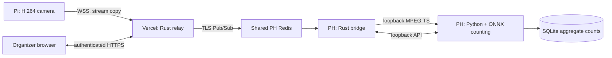

# Video transport and public dashboard

The Rust transport connects the Pi to the PH counting service through Vercel and the existing PH Redis server. The organizer dashboard is intended for `https://attendance.purduehackers.com`. It requires the existing `organizer` login; camera publishing uses a separate token.



Rust owns the transport, reconnect buffering, authentication and HTTP relay. The counting worker continues to use native ONNX Runtime and OpenCV through Python. Moving those calls to Rust would not inherently accelerate model inference. No throughput improvement is claimed without measurement.

## What is stored

The Pi remuxes H.264 into MPEG-TS with FFmpeg `-c:v copy`; it does not re-encode. Compressed video travels through Vercel and the shared PH Redis instance. Redis **Pub/Sub only** is used: no video keys, streams, lists or recordings are created. Pub/Sub payloads are not included in Redis snapshots. The Pi retains at most two seconds / 4 MiB of unacknowledged compressed data in RAM. The bridge and decoder have bounded live buffers. Preview JPEGs travel through the authenticated dashboard API and are not saved by the application. Aggregate session data stays in the existing PH SQLite database.

This architecture sends live imagery through Vercel. It is not an entirely local video path. Application logs contain neither frames nor credentials; no recording/upload/archive endpoints are provided.

## Redis

Use the existing shared service at `redis.phack.sh:6379`, with a `rediss://` URL and normal CA/hostname verification. On November 9, 2026 its certificate verified for that hostname; the older `redis.server.purduehackers.com` name did not. Do not work around a mismatch by disabling verification.

Use a dedicated `attendance` ACL, with channel access restricted to `attendance:*` and only these commands:

```text
user attendance on #PASSWORD_SHA256 resetkeys resetchannels ~attendance:* &attendance:* -@all +ping +publish +subscribe +unsubscribe +client|setinfo +client|setname
```

An admin must put the real hashed ACL line in the shared server's `/etc/redis/acl.conf`. A runtime `ACL SETUSER` alone does **not** survive a Redis restart. The shared container mounts that configuration read-only, so `ACL SAVE` cannot persist a new user. Never edit other projects' ACLs or copy their credentials. The project does not need database read/write or administration commands.

Production uses namespace `attendance:v1`. Local integration tests use an isolated Redis process and random namespace. Keep only one production bridge and one Pi publisher active.

## Deploy the relay

The root Cargo manifest defines the native Vercel Rust function at `api/relay.rs`. `vercel.json` routes requests to it, selects Cleveland, and sets a 300-second function limit. Configure these **production** environment variables in the PH team's `attendance-camera` Vercel project:

- `REDIS_URL`: shared Redis URL for the project's ACL user.
- `REDIS_NAMESPACE=attendance:v1`.
- `ATTENDANCE_TOKEN`: same organizer password as the PH worker (at least 32 characters).
- `CAMERA_TOKEN`: a different randomly generated password (at least 32 characters).
- `PUBLIC_ORIGIN=https://attendance.purduehackers.com`.

Do not give production credentials to fork/preview builds. Local relay testing uses `RELAY_BIND=127.0.0.1:3000` and `PUBLIC_ORIGIN=http://127.0.0.1:3000`. Only loopback Redis may use unencrypted `redis://`.

The browser serves the existing dashboard. Requests are forwarded to a fixed allowlist of counting API routes through correlated Pub/Sub requests and replies. Arbitrary URLs, paths and headers are not forwarded. Mutations require the configured origin when an Origin header is present. Request bodies are capped at 16 KiB, replies at 1 MiB, with bounded timeouts. Repeated delivery of the same command ID is deduplicated for one minute in the bridge. This is not a durable job queue: an ambiguous response after a worker crash must be checked in the dashboard before retrying.

## PH bridge service

Run under `p-attendance`, alongside `attendance-server.service`:

```bash
sudo -u p-attendance -i
cd ~/attendance-camera
cargo build --locked --release --bin attendance-bridge
install -Dm755 target/release/attendance-bridge local/bin/attendance-bridge
# Create local/transport.env using install/transport.env.example.
# It needs only REDIS_URL, REDIS_NAMESPACE and ATTENDANCE_TOKEN.
chmod 600 local/transport.env
cp install/attendance-bridge.service ~/.config/systemd/user/
loginctl enable-linger "$USER"
systemctl --user daemon-reload
systemctl --user enable --now attendance-bridge
```

The bridge listens only on `127.0.0.1:18555`. The worker API stays on `127.0.0.1:8000`. After the new live transport is verified, set `ATTENDANCE_CAMERA_URL=http://127.0.0.1:18555/cam.ts` in the worker's private environment and restart `attendance-server`. No Caddy route or additional public server listener is required.

## Pi publisher service

Build `camera-publisher` on the Pi's OS/architecture, or cross-compile for that exact target. Install FFmpeg. Keep the existing MediaMTX camera service, using its reachable local RTSP address:

```bash
cargo build --locked --release --bin camera-publisher
sudo install -m755 target/release/camera-publisher /usr/local/bin/camera-publisher
sudo install -d -m700 /etc/attendance-camera
# Create /etc/attendance-camera/publisher.env with CAMERA_RELAY_URL,
# CAMERA_SOURCE and CAMERA_TOKEN only. The system service reads it as root.
sudo chmod 600 /etc/attendance-camera/publisher.env
sudo cp install/camera-publisher.service /etc/systemd/system/
sudo systemctl daemon-reload
sudo systemctl enable --now camera-publisher
```

Use `wss://attendance.purduehackers.com/ingest`; tokens belong in headers, never query strings. The Pi does not receive the organizer password or Redis credentials. If MediaMTX binds specifically to the Pi's Tailscale address, use that address instead of `127.0.0.1` for `CAMERA_SOURCE`.

Verify a fresh preview and a controlled crossing test before removing the old SSH tunnel. Disable `attendance-camera-tunnel.service` on the Pi only after that verification, then remove only its dedicated restricted key from the old server account. Keep the old transport configuration for rollback.

## Reconnects and uncertainty

Vercel [supports WebSockets](https://vercel.com/docs/functions/websockets), but a socket has the function's duration limit and may reconnect to another instance. The relay closes at 240 seconds, before its 300-second limit. The Pi reconnects with jitter and backoff, replaying only unacknowledged data inside the bounded RAM window. Redis connects the different relay instances to the same bridge.

Each packet carries a stream ID, sequence and capture-side timestamp. Duplicates are acknowledged without being decoded twice. A missing packet, changed stream, stale data, Redis failure or slow decoder ends the local HTTP stream; the Python capture reconnects and resets tracking. An active session is then marked for manual reconciliation. Continuous data preserved across a short reconnect keeps the decoder running. This prevents silently treating a video outage as zero people. Both hosts need synchronized clocks.

## Verification

```bash
cargo fmt --check
cargo clippy --locked --all-targets -- -D warnings
cargo test --locked --all-targets
cargo build --locked --bins
uv run scripts/test_transport.py
uv run pytest -q
```

The integration test starts an isolated Redis instance, two relay processes, a bridge and a fixture backend. It checks authentication, CSRF, request limits, cross-instance packet delivery, duplicate suppression, a forced video gap, planned socket rotation, command deduplication, and zero stored Redis keys. Synthetic transport checks are not camera/counting accuracy validation.
